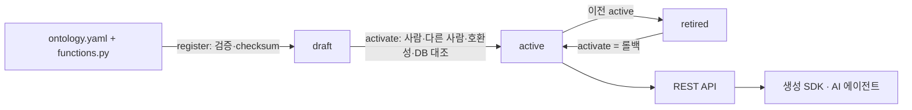

# 03. Mini Ontology Engine — MiniOnto (PART 4)

팔란티어식 온톨로지의 핵심 개념(Object·Link·Interface·Function·Action·Security)을
**YAML 정의(메타데이터)** 로 기술하고, 범용 엔진이 그 정의를 읽어 동작하도록 만듭니다.

> MiniOnto와 그 YAML 문법은 이 책의 자체 설계입니다. 팔란티어 공식 문법이나 내부 구현이 아닙니다.

## 진행 현황

| 장 | 구성 요소 | 상태 |
|---|---|---|
| 16 | 메타모델·YAML DSL·검증기 | ✅ v0.1 |
| 17 | Object Engine · Link Engine (조회·관계 탐색) | ✅ v0.1 |
| 18 | Function Engine · Action Engine (계산·검증된 실행·승인·감사) | ✅ v0.1 |
| 19 | Ontology Registry · API · SDK (버전 관리·REST API·타입 SDK 생성) | ✅ v0.1 |
| 20 | 상태 머신 · 상태 전이 강제 · 동시 변경 감지 · 지금 가능한 Action 조회 | ✅ v0.1 |
| 21 | 토큰 인증(JWT·scope) · 행·속성 권한 정책 · 정책 판단 기록 · 승인 기한·미리보기·알림 | ✅ v0.1 |
| 22 | 잠금 대기 시간 · 멱등 키 · 승인 요청 중복 방지 · 오류 분류와 자동 재시도 · 보상 Action | ✅ v0.1 |
| 23 | 아웃박스 발송 작업자 · 재시도·순서·dead · 외부 멱등 키 · 발송 결과를 객체로 기록 | ✅ v0.1 |
| 24 | 감사 로그(객체 이력·실행 추적·해시 체인·완전성 점검·지표) · 이벤트 구독 · 피드백 | ✅ v0.1 |
| 25 | AI 에이전트 인터페이스: 실행자별 컨텍스트·도구 6개·다음 행동 안내·읽은 값 expect·업무 단위 멱등 키·확인 모드 | ✅ v0.1 |
| 26 | MCP 서버(stdio·Streamable HTTP): 토큰별 도구 목록·isError·리소스·프롬프트·DB 세션·사람의 확인 CLI | ✅ v0.1 |
| 27 | LangGraph 업무 그래프: 탐지·분석·메모(LLM)·실행·승인 대기 중단/재개·실행 기록 대조·보고, PostgreSQL 체크포인트 | ✅ v0.1 |
| 29 | OWL ↔ 운영형 매핑: 매핑 검증·공리 데이터 확인·RDF 내보내기(권한 정책 적용)·OWL 에서 정의 초안 | ✅ v0.1 |
| 30 | OWL 추론 → 고객 분류(CustomerSegment): 모순이면 중단, 시스템 Action 으로만 반영, 사람의 해제 존중, 일부 그래프로는 해제 안 함 | ✅ v0.1 |
| 32 | Action 변경 값에 Function 결과 쓰기(되쓰기 계산) · 검증기 확인 — Northwind 발주·금액별 승인 | ✅ v0.1 |
| 33 | 세무 v0.8.0: 고객 문의 객체·Action, 자료 현황 등록 조건 · 업무 규칙 목록 21개와 대조 도구 (08-tax-os-project) | ✅ v0.1 |

> 세무 정의(taxos)는 장이 진행되며 버전이 오릅니다. 각 장 원고의 출력은 그 장의 태그 기준입니다.
>
> | 태그 | 원고 | taxos |
> |---|---|---|
> | `part4` | 15~19장 | v0.1.0 |
> | `ch20` | 20장 | v0.2.0 (상태 머신, Action 4개 추가) |
> | `ch21` | 21장 | v0.3.0 (보안 정책, 승인 기한) |
> | `ch22` | 22장 | v0.4.0 (보상 Action) |
> | `ch23` | 23장 | v0.5.0 (Notification 객체, 시스템 실행자) |
> | `main` | 24장~ | v0.6.0 (구독 auto_start_review) |

## 구조

```text
03-ontology-engine/
├── minionto/                 # 범용 엔진 (도메인 코드 없음)
│   ├── metamodel.py          # DSL 문법 = Pydantic 모델
│   ├── schema.py             # 링크 색인, 경로 해석 (customer.accountant.max_workload)
│   ├── validator.py          # 참조 무결성 검사
│   ├── db.py                 # 실제 PostgreSQL 스키마 대조
│   ├── query.py              # 조건식 → SQL 컴파일러 (경로 → JOIN, some/none → EXISTS)   [17장]
│   ├── objects.py            # OntologyClient · ObjectSet · OntoObject                    [17장]
│   ├── functions.py          # Function Engine: 구현 로드, 입력 변환, 출력 계약 검사      [18장]
│   ├── actions.py            # Action Engine: 권한→조건→승인→변경→Outbox·감사 (한 트랜잭션) [18장]
│   ├── registry.py           # Ontology Registry: 버전 등록·비교(diff)·활성화·롤백             [19장]
│   ├── describe.py           # 공개 메타데이터 (물리 매핑을 숨긴 API·SDK·에이전트용 설명)     [19장]
│   ├── api.py                # FastAPI: 객체·링크·Function·Action·승인 엔드포인트              [19장]
│   ├── sdk.py                # 원격 클라이언트 (httpx 만 사용, 로컬 ObjectSet 과 같은 모양)    [19장]
│   ├── codegen.py            # SDK Generator: 메타데이터 → 타입 있는 Python SDK               [19장]
│   ├── states.py             # 상태 머신: 전이 규칙 조회, Mermaid 다이어그램                   [20장]
│   ├── auth.py               # 인증: JWT 발급·검증(JwtAuth), 개발용 키(ApiKeyAuth), scope        [21장]
│   ├── policy.py             # 권한 정책: 행·속성 정책 집행, 판단 기록                         [21장]
│   ├── outbox.py             # 아웃박스 발송 작업자: 재시도·순서·SKIP LOCKED·dead               [23장]
│   ├── audit.py              # 감사 로그: 객체 이력·실행 추적·완전성 점검·운영 지표             [24장]
│   ├── subscriptions.py      # 이벤트 구독: check() 후 시스템 실행자로 Action, 재처리          [24장]
│   ├── agent.py              # AI 에이전트 인터페이스: 컨텍스트·도구 정의·도구 실행(AgentSession) [25장]
│   ├── llm.py                # OpenAI 호환 API 도구 호출 루프 (run_agent · run_mcp_agent)     [25·26장]
│   ├── mcp_server.py         # MCP 서버: JWT 인증, scope 별 도구, DB 세션(SessionStore)        [26장]
│   ├── workflow.py           # LangGraph 업무 그래프: 신고 지연 위험 고객 처리, 중단·재개      [27장]
│   ├── semantic.py           # OWL ↔ 운영형 매핑: 검증·공리 확인·RDF 내보내기·정의 초안       [29장]
│   ├── reasoning.py          # OWL-RL 추론 → 고객 분류 동기화 (시스템 Action)                 [30장]
│   ├── loader.py, cli.py
├── examples/17_object_link_engine.py   # PART 2 SPARQL 질문을 엔진으로 다시 풀기
├── examples/17_compare_sparql.py       # SPARQL(RDF 그래프)과 엔진(운영 DB)의 결과 ID 집합 대조
├── examples/18_function_action_engine.py  # Action 실행·거부·승인 시나리오 (기본은 롤백)
├── examples/19_registry_api_sdk.py        # 등록→활성화 관문→API→생성 SDK (기본은 롤백)
├── examples/20_state_transitions.py       # 지금 가능한 Action → 신고 업무 상태 전이 → 동시 변경 감지
├── examples/21_security_hitl.py           # 토큰 인증 → 역할별 조회 → 정책 위반 차단 → 승인 워크플로
├── examples/22_reliability.py             # 잠금 시간 초과·재시도 → 멱등 키 → 중복 방지 → 오류 분류 → 보상
├── examples/23_outbox_notifications.py    # 직접 호출의 사고 → 아웃박스 발송 → 장애·순서 → 중단 → 영구 실패
├── examples/mock_notifier.py              # 실습용 모의 발송 서비스 (멱등 키, 일시 장애, 수신 거부)
├── examples/24_audit_feedback.py          # 요청 이후 추적 → 이력·추적 → 완전성 점검·재처리 → 피드백 → 지표
├── examples/25_agent_interface.py         # 컨텍스트 크기 → 도구 목록 → 도구 직접 호출 → 확인 모드 → (--llm) LLM 에이전트
├── examples/26_mcp_server.py              # 토큰별 도구 → 결과·리소스·프롬프트 → 세션 이어 가기·확인 → HTTP → (--llm) MCP 호스트
├── examples/27_workflow.py                # 그래프 구조 → 승인 대기 → 재개 → 실행 직후 중단 → 판단 뒤 변경 → 승인 대기 중 변경
├── examples/dev_api_keys.yaml             # 개발용 API 키 (토큰 → 실행자)
├── ontologies/               # 도메인 정의 (엔진 코드 수정 없이 교체)
│   ├── taxos/ontology.yaml       # 세무 v0.8.0: Object 11 · Link 14 · Function 6 · Action 16 · 상태 머신 5 · 정책 2 · 구독 1
│   ├── taxos/functions.py        # Function 구현 (계산만, 테이블 이름 없음)
│   ├── taxos/integrations.py     # 외부 연동: 이벤트 → 알림 메시지, 결과를 Action 으로 기록 (23장)
│   └── northwind/ontology.yaml   # 주문·재고 v0.2.0: Object 8 · Link 9 · Function 8 · Action 4 · 정책 1 (32장 발주)
└── schema/minionto.schema.json   # 에디터 자동완성용 JSON Schema
```

## 사용법

```bash
cd 03-ontology-engine
uv run python -m minionto validate ontologies/taxos/ontology.yaml --db   # 문법 → 참조 → DB 대조
uv run python -m minionto describe ontologies/taxos/ontology.yaml --db   # 객체·링크·Action 요약
uv run python -m minionto schema -o schema/minionto.schema.json          # JSON Schema 생성
```

`--db`는 저장소 루트 `.env`의 `TAXOS_DATABASE_URL`·`NORTHWIND_DATABASE_URL`을 씁니다.
VS Code의 YAML 확장을 쓰면 정의 파일 첫 줄의 `$schema` 주석으로 자동완성과 오류 표시가 됩니다.

## 3단계 검증

| 단계 | 검사 내용 | 예 |
|---|---|---|
| 1. 문법 (`metamodel.py`) | 키 오타, 필수 항목, 형식 조합 | `cardinalty` 오타, enum에 values 없음, 조건식에 형식 두 개 |
| 2. 참조 (`validator.py`) | 가리키는 대상이 실제로 있고 뜻이 통하는가 | 없는 객체 타입·속성·링크·파라미터·역할, 허용되지 않은 enum 값, 여러 개로 갈라지는 경로를 단일 비교에 사용, 새 객체의 필수 속성 누락, 기본키 수정 |
| 3. DB (`db.py`) | 정의와 운영 DB가 맞는가 | 없는 테이블·컬럼, 타입 불일치, PRIMARY KEY 제약 없음, 매핑하지 않은 컬럼(경고) |

---

## DSL 요약 (v0.1)

### Object Type · Property

```yaml
object_types:
  Customer:
    display_name: 고객
    source: { table: customers, primary_key: customer_id }   # primary_key 는 '속성' 이름
    title_property: company_name
    implements: [Contactable]
    properties:
      business_status: { type: enum, values: [영업, 휴업, 폐업], column: status, required: true }
```

- 속성 타입: `string` `integer` `decimal` `float` `boolean` `date` `datetime` `enum` `binary`
- `column`을 생략하면 속성명과 같은 컬럼. 속성명을 업무 용어로 바꿀 수 있다(`status` → `business_status`).
- `source.id_strategy`: `provided`(기본) · `uuid` · `prefixed_sequence`(+`id_prefix`) — Action이 새 객체를 만들 때 ID 생성 방식

### Interface

여러 객체 타입이 공유하는 속성 형태. `implements`한 객체 타입은 해당 속성을 같은 타입으로 가져야 한다.

### Link Type

```yaml
link_types:
  customer_tax_returns:
    { from: Customer, to: TaxReturn, cardinality: one_to_many,
      from_key: customer_id, to_key: customer_id, forward_name: tax_returns, reverse_name: customer }
  order_products:                          # 다대다는 연결 테이블(through)로
    from: Order
    to: Product
    cardinality: many_to_many
    through: { table: order_details, from_column: order_id, to_column: product_id }
    forward_name: products
    reverse_name: orders
```

`forward_name`은 from 쪽에서, `reverse_name`은 to 쪽에서 부르는 이름이다. 이 이름으로 경로를 만든다:
`TaxReturn` 기준 `customer.accountant.max_workload`.

### Function

```yaml
functions:
  has_capacity:
    description: 담당 고객 수가 최대치 미만인가
    inputs:  { accountant: { type: object, object_type: Accountant } }
    returns: { type: boolean }
    implementation: functions:has_capacity      # ontologies/taxos/functions.py 의 함수 (18장)
```

파라미터 타입: 속성 타입 + `object`(object_type) · `list`(items) · `struct`(fields)

### 조건식

Action의 실행 조건·권한·승인 조건에 쓴다. 아래 형식 중 **정확히 하나**를 쓴다.

| 형식 | 예 |
|---|---|
| 비교 | `{ field: customer.risk_level, op: eq, value: 높음 }` |
| 논리 | `{ all: [...] }` `{ any: [...] }` `{ not: {...} }` |
| 링크 수량 | `{ some: { link: submissions, where: {...} } }` `{ none: {...} }` |
| 함수 | `{ function: has_capacity, args: { accountant: $params.accountant } }` |

- 연산자: `eq` `ne` `in` `not_in` `gt` `gte` `lt` `lte` `is_null` `not_null`
- `field`는 Action 대상 객체 기준 경로이거나 `$actor.*`·`$params.*`
- `$`로 시작하는 값은 참조: `$actor.id|role|type`, `$params.<이름>`, `$target.<경로>`, `$now`, `$today`
- 여러 객체로 갈라지는 경로(`submissions.status`)는 단일 비교에 쓸 수 없다 → `some`/`none` 사용

### Action

```yaml
actions:
  request_missing_documents:
    display_name: 누락 자료 요청
    target: TaxReturn
    parameters: { note: { type: string, required: false } }
    preconditions:                       # 업무 규칙: 실패 시 message 를 돌려준다
      - message: 자료수집중인 신고만 자료를 요청할 수 있습니다.
        check: { field: status, op: eq, value: 자료수집중 }
    permission:                          # 누가 실행할 수 있는가
      roles: [세무사, 실무자, AI비서]
      actor_types: [human, agent]
      check: { any: [ ... ] }
    approval:                            # 언제 사람의 승인이 필요한가
      required_if: { all: [ { field: customer.risk_level, op: eq, value: 높음 },
                            { field: $actor.type, op: eq, value: agent } ] }
      approver_roles: [세무사]
    edits:                               # 무엇을 바꾸는가 (한 트랜잭션)
      - update_linked: submissions
        where: { field: status, op: eq, value: 미요청 }
        set: { status: 요청됨, requested_at: $today }
      - create: Task
        values: { customer_id: $target.customer_id, task_type: 자료요청, created_by: $actor.type, ... }
    emits: [documents_requested]         # 실행 후 발행할 이벤트 (Outbox, 23장)
```

edit 형식: `{update: target, set}` · `{update_linked: <링크>, where, set}` · `{create: <ObjectType>, values}`

Action은 **코드가 아니라 선언**이다. 무엇을 확인하고(preconditions), 누가 하며(permission),
언제 사람이 개입하고(approval), 무엇을 바꾸는지(edits)를 한곳에 적는다.
사람·웹 화면·AI 에이전트가 모두 이 정의를 거쳐 실행하므로, 규칙을 도구마다 따로 구현하지 않아도 된다.

---

## Object Engine · Link Engine (17장)

테이블·컬럼·조인 키를 몰라도 **객체·속성·링크 이름**으로 조회한다.

```python
from minionto import OntologyClient

onto = OntologyClient.open("ontologies/taxos/ontology.yaml", today="2027-01-18")

# 집합 정의 — 실행 전까지 DB를 읽지 않는다 (where 는 AND 로 쌓인다)
returns = (onto.objects("TaxReturn")
           .where(status="자료수집중")                                   # 속성=값
           .where({"field": "customer.risk_level", "op": "eq", "value": "높음"})   # 링크 경로
           .where({"some": {"link": "submissions",
                            "where": {"field": "status", "op": "eq", "value": "미요청"}}})
           .order_by("due_date", "-customer.risk_level"))

print(returns.sql())                                # 생성된 SQL
returns.count(); returns.first(); returns.limit(10).all()
returns.rows("return_id", "customer.company_name", "customer.accountant.name")   # 표 조회
returns.count_by("customer.accountant.name")        # 그룹별 개수
onto.objects("Customer").pivot("tax_returns")        # 집합 단위 링크 이동 (Search Around)

r = returns.first()
r.customer.accountant.name                           # 단일 값 링크 → 객체
r.submissions.where(status="미요청").all()          # 여러 값 링크 → ObjectSet
```

```bash
uv run python -m minionto query ontologies/taxos/ontology.yaml Accountant \
    -w accountant_id=A002 -p customers -w risk_level=높음 --select customer_id,risk_level -v
uv run python examples/17_object_link_engine.py --sql
```

### 번역 규칙

| 온톨로지 표현 | SQL |
|---|---|
| 속성 `status` | `t0.status` (속성명 ≠ 컬럼명이면 매핑: `business_status` → `status`) |
| 단일 값 경로 `customer.accountant.name` | `LEFT JOIN` (같은 경로는 한 번만 조인) |
| `some` / `none` | 상관 `EXISTS` / `NOT EXISTS` |
| 다대다 링크 | 연결 테이블(through)을 거치는 `EXISTS` |
| `pivot(link)` | 도착 타입 기준 `EXISTS(역방향 링크 → 원래 조건)` |
| `$target.<경로>` | 대상 객체의 다른 속성과 비교 (`shipped_date > $target.required_date`) |
| enum 정렬 | 정의한 값 순서 (`낮음 < 보통 < 높음`), 가나다순 아님 |

- 여러 값 링크를 비교·정렬에 쓰면 오류: 결과 행이 중복되거나 뜻이 모호해지기 때문 → `some`/`none`/`pivot`
- `ne` 는 `IS DISTINCT FROM`, `not` 은 `NOT COALESCE(…, FALSE)` — NULL 이 섞여도 '아니다'가 참
- 값은 `sql.Literal` 로 넣어 SQL 인젝션이 생기지 않고, enum 은 허용 값인지 먼저 확인한다
- Function 조건은 SQL로 바꾸지 않는다 (18장 Function Engine이 Python에서 평가)

### PART 2(SPARQL)와 결과 대조

| 질문 | SPARQL (PART 2) | MiniOnto (17장) |
|---|---|---|
| 기한 임박 + 자료 미제출 고객 | 92명 | 92명 |
| 자료 현황 미등록 현재 신고 | 6건 | 6건 |
| 업무량 한도 초과 담당자 | A002, A003 | A002, A003 |

같은 의미 모델을 RDF 그래프에서 묻든 운영 DB에서 묻든 답이 같다.

---

## Function Engine · Action Engine (18장)

### Function: 계약은 YAML, 계산은 Python

```python
# ontologies/taxos/functions.py — 첫 인자 ctx 로 온톨로지 조회·기준일을 받는다
def has_capacity(ctx, accountant):
    return accountant.customers.count() < accountant.max_workload
```

```python
onto.functions.call("has_capacity", accountant="A002")          # 기본키만 넘겨도 객체로 변환 → False
onto.functions.call("filing_delay_risk", customer="C0008")       # {"score": 82, "level": "높음", "reasons": [...]}
```

엔진은 정의에 없는 입력·빠진 필수 입력·없는 객체를 막고, **반환값이 선언한 타입과 다르면 오류**를 낸다
(`boolean` 이라 했는데 `None` 을 돌려주는 구현). 링크 속성처럼 온톨로지로 표현하지 못하는 계산은
`ctx.sql()` 탈출구를 쓴다 (`order_total`).

### Action: 선언된 업무를 검증하고 한 트랜잭션으로 실행

```python
eng = onto.actions
eng.candidates("request_missing_documents", actor=ai)       # 실행 가능한 대상 (실행 조건 = 조회 조건)
r = eng.apply("request_missing_documents", "R00006", actor=ai, params={"note": "..."}, dry_run=True)
r.status, r.messages, r.changes                                # 미리보기 → 롤백
eng.apply(...)                                                 # 실제 실행
eng.decide(approval_id, approver, approve=True)                # 승인 → 요청자 권한으로 재검사 후 실행
```

| 단계 | 내용 | 실패 시 `status` |
|---|---|---|
| 역할 | `permission.roles`, `actor_types` (입력 검사보다 먼저 — 권한 없는 실행자에게 정보를 주지 않음) | `denied` |
| 입력 | 파라미터 타입·필수·enum, object 파라미터의 객체 존재 | `invalid` |
| 대상 잠금 | `SELECT … FOR UPDATE` — 같은 대상의 동시 실행을 줄 세움 | `invalid` (없음) |
| 권한 조건 | `permission.check` (본인 담당 고객만 등) | `denied` |
| 실행 조건 | `preconditions` — 실패한 규칙의 message 를 **모두** 돌려줌 | `rejected` |
| 승인 | `approval.required_if` 가 참이면 실행하지 않고 승인 요청 저장 | `approval_required` |
| 변경 | `edits` 순서대로. `prefixed_sequence` ID 는 advisory lock 으로 채번 | DB 오류 → `failed` (전체 롤백) |
| 이벤트·감사 | `minionto.outbox`, `minionto.action_log` — 변경과 **같은 트랜잭션** | |

- 조건식에 Function 이 있으면 `all/any/not` 을 Python 에서 나눠 평가하고, 나머지는 SQL 한 번으로 평가한다.
- 승인자는 `approver_roles` 의 **사람**이어야 하고 요청자 본인은 승인할 수 없다(직무 분리).
  승인 시점에 실행 조건을 다시 검사하므로, 그사이 다른 사람이 처리했으면 요청은 `expired` 가 된다.
- 엔진 테이블은 도메인 DB의 `minionto` 스키마에 자동 생성된다. 업무 데이터와 같은 DB에 두어야
  변경·이벤트·감사 기록을 하나의 트랜잭션으로 묶을 수 있다(Transactional Outbox, 23장).

```bash
uv run python examples/18_function_action_engine.py            # 체험 모드: 끝나면 전부 롤백
uv run python examples/18_function_action_engine.py --commit   # 실제 반영 (되돌리기: bash scripts/load_taxos.sh)
```

## Ontology Registry · API · SDK (19장)

엔진을 **외부에 여는** 단계입니다. 정의는 Registry 에서 버전으로 관리하고, 활성 버전만 API 로 서빙하며,
API 메타데이터로 타입이 있는 SDK 를 생성합니다.



### Registry: 등록과 반영을 나눈다

```bash
uv run python -m minionto registry register ontologies/taxos/ontology.yaml --actor A001,human
uv run python -m minionto registry activate taxos 0.1.0 --actor A005,human    # 등록자와 다른 사람
uv run python -m minionto registry diff taxos 0.1.0 0.2.0
uv run python -m minionto registry history
```

| 규칙 | 이유 |
|---|---|
| 정의 YAML 과 Function 코드를 함께 저장, checksum 으로 식별 | 활성 버전은 디스크 파일이 바뀌어도 그대로 재현 |
| 같은 버전 번호에 다른 내용 등록 불가 | 등록된 버전은 불변. 바꾸려면 version 을 올린다 |
| 초안 등록은 AI 도 가능, 활성화는 **사람**이 | LLM 이 만든 업무 규칙은 사람의 검토 후에만 실행 환경에 들어간다 |
| 등록자 본인은 draft 를 활성화할 수 없음 | 직무 분리 (18장 승인과 같은 원칙) |
| breaking 변경은 `--allow-breaking` 이 있어야 활성화 | 기존 API·SDK 사용자 보호 |
| 활성화 직전 DB 대조 검사 | 실제 스키마에 없는 컬럼을 가리키는 정의 차단 |

변경은 **사용자에게 미치는 영향**으로 분류합니다 (`diff`, 권장 버전 `suggest_version`).

| 분류 | 예 | 권장 버전 |
|---|---|---|
| breaking | 객체 타입·속성·링크·Action 삭제, 타입 변경, enum 값 삭제, 필수 입력 추가, 이벤트 발행 중단 | 주 버전 |
| policy | 실행 조건·권한·승인 규칙·변경 내용 수정 (입력 형식은 같지만 **업무 규칙**이 바뀜 → 검토) | 부 버전 |
| compatible | 객체·속성·Action 추가, 선택 입력 추가, **테이블·컬럼·조인 키 변경** | 부 버전 |

물리 매핑(테이블·컬럼) 변경이 compatible 인 이유: API 는 업무 용어만 노출하므로 DB 구조를 바꿔도 사용자는 모릅니다.

### API: 업무 용어로 된 엔드포인트

```bash
uv run python -m minionto serve ontologies/taxos/ontology.yaml ontologies/northwind/ontology.yaml     --keys examples/dev_api_keys.yaml --today 2027-01-18          # 개발: 파일을 바로 서빙
uv run python -m minionto serve --registry --keys examples/dev_api_keys.yaml   # 운영: 활성 버전만
# 문서: http://127.0.0.1:8800/docs (OpenAPI)
```

| 메서드·경로 (`/v1/ontologies/{o}` 아래) | 내용 |
|---|---|
| `GET /` | 공개 메타데이터 — 객체·속성·링크·Function·Action(권한·승인·실행 조건). 테이블·컬럼·구현 위치는 없음 |
| `POST /objects/{type}/search` | `where`·`steps`(조건/pivot 순서)·`order_by`·`select`·`limit`·`offset` |
| `POST /objects/{type}/aggregate` | `count_by`, `metrics` |
| `GET /objects/{type}/{pk}`, `…/{pk}/links/{link}` | 객체 하나, 링크 따라가기 |
| `POST /functions/{fn}` | `{"args": {...}}` |
| `GET /actions/{a}/candidates` | **토큰의 실행자**가 실행할 수 있는 대상 |
| `POST /actions/{a}/apply` | `{"target", "params", "dry_run"}` → 200 completed · 202 approval_required · 403 denied · 409 rejected · 422 invalid |
| `GET /approvals`, `POST /approvals/{id}/decide` | 내 역할이 처리할 승인 요청 |

```bash
curl -s -H "Authorization: Bearer dev-ai-agent" -H "Content-Type: application/json"   -d '{"where":[{"field":"status","op":"eq","value":"자료수집중"}],"select":["return_id","due_date"],"limit":2}'   http://127.0.0.1:8800/v1/ontologies/taxos/objects/TaxReturn/search
```

- 실행자(actor)는 **토큰에서** 정합니다. 본문에 `actor` 를 넣어도 무시됩니다. 개발용 키는 21장에서 실제 인증으로 바꿉니다.
- 금액(decimal)은 정밀도를 지키려고 문자열(`"440.00"`)로 보냅니다.

### SDK: 메타데이터 → 타입 있는 클라이언트

```bash
uv run python -m minionto sdk ontologies/taxos/ontology.yaml -o build/taxos_sdk.py
uv run python -m minionto sdk --url http://127.0.0.1:8800 --ontology northwind --token dev-nw-sales -o build/northwind_sdk.py
```

```python
from taxos_sdk import TaxosClient
sdk = TaxosClient("http://127.0.0.1:8800", token="dev-ai-agent")
sdk.check_version()                                         # 주 버전이 다르면 오류 → SDK 재생성
rows = sdk.TaxReturn.where(status="자료수집중").order_by("due_date").limit(5).all()   # list[TaxReturn]
rows[0].due_date                                            # datetime.date
sdk.TaxReturn.where(return_id="R00006").pivot("customer").first()                   # Customer
sdk.request_missing_documents("R00006", note="기한 전 제출 부탁드립니다", dry_run=True)
```

- 객체 타입마다 dataclass (enum → `Literal`, date·decimal 변환). `from_dict` 는 모르는 키를 무시하므로
  서버에 속성이 추가돼도(compatible) 기존 SDK 가 깨지지 않습니다.
- Action 메서드 독스트링에 권한·승인·실행 조건이 들어가 에디터와 AI 코딩 도구가 그대로 읽습니다.
- 생성 SDK 는 `minionto.sdk`(httpx 만 사용)에 의존하며, 타입 없이 쓰려면 `RemoteOntology` 를 바로 씁니다.

```bash
uv run python examples/19_registry_api_sdk.py            # Registry·API·SDK 한 번에 (전부 롤백)
uv run python examples/19_registry_api_sdk.py --commit   # Registry 등록·활성화만 남김
```

## 상태 머신과 상태 전이 (20장)

enum 속성 하나를 상태로 정하고, **어떤 Action 이 어떤 상태를 어디로 바꾸는지** 객체 타입 아래에 선언합니다.
여기 없는 전이는 엔진이 막습니다.

```yaml
  TaxReturn:
    ...
    state_machine:
      property: status
      initial: [자료수집중]
      terminal: [신고완료, 기한후신고]
      transitions:                                   # Action 이름 → 전이
        start_review:         { from: 자료수집중, to: 검토중 }
        return_to_collection: { from: 검토중,     to: 자료수집중 }
        complete_filing:      { from: 검토중,     to: 신고완료 }
        file_late:            { from: 검토중,     to: 기한후신고 }
```

엔진이 하는 일

| 시점 | 동작 |
|---|---|
| 정의 검증 | Action 의 edits 가 상태를 바꾸면 전이가 선언되어 있는지, to 와 값이 같은지, 링크 객체는 where 로 시작 상태를 제한했는지, 새 객체는 initial 상태인지, 종료 상태에서 나가는 전이가 없는지 |
| 실행 전 | 대상의 현재 상태가 from 에 없으면 rejected — 다른 실행 조건의 실패 사유와 **함께** 돌려준다. `candidates()` 도 시작 상태를 조회 조건으로 쓴다 |
| 변경 시 | 바꿀 행을 `FOR UPDATE` 로 잠그고 다시 읽어 **동시 변경을 감지**하고, 링크 객체까지 모든 상태 변경이 선언된 전이인지 다시 확인한다. 어긋나면 전체 롤백 (rejected) |
| 변경 후 | 일어난 전이를 `minionto.state_transitions` 에 기록 (`actions.history(type, pk)`) |

```python
onto.actions.available("TaxReturn", "R00006", actor=AI)      # 지금 할 수 있는 일 (아무것도 바꾸지 않음)
onto.actions.check("return_to_collection", "R00006", actor=TAX)   # → needs_input (reason)
onto.actions.apply("complete_filing", "R00006", actor=TAX, expect={"status": "검토중"})   # 읽은 뒤 바뀌었으면 rejected
onto.actions.history("TaxReturn", "R00006")
```

```bash
uv run python -m minionto states ontologies/taxos/ontology.yaml TaxReturn --mermaid
uv run python -m minionto available ontologies/taxos/ontology.yaml TaxReturn R00006 --actor agent-01,AI비서,agent --today 2027-01-18
uv run python -m minionto run ontologies/taxos/ontology.yaml complete_filing R00024 --actor A001,세무사,human --expect status=검토중
uv run python -m minionto history ontologies/taxos/ontology.yaml TaxReturn R00006
uv run python examples/20_state_transitions.py
```

API: `GET .../objects/{type}/{pk}/actions`, `GET .../objects/{type}/{pk}/history`, apply 요청의 `expect`.
SDK: `sdk.available()`, `sdk.history()`, Action 메서드의 `expect=` 인자, 독스트링의 상태 전이.

## 인증 · 권한 정책 · 승인 워크플로 (21장)

```yaml
security:
  row_policies:                     # 행: 이 실행자에게 보이는 객체 (보이지 않으면 Action 도 불가)
    own_customers:
      description: 실무자는 본인 담당 고객과 그 고객의 신고·자료·업무·상담·위험 이벤트만 다룬다
      roles: [실무자]
      rules:
        Customer:  { field: accountant_id, op: eq, value: $actor.id }
        TaxReturn: { field: customer.accountant_id, op: eq, value: $actor.id }
        ...
  property_policies:                # 속성: 결과에서 빠지고, 조건·정렬·선택에 쓰면 거부
    personal_info:
      description: AI 에이전트는 고객·담당자의 개인 식별 정보를 보지 않는다
      actor_types: [agent]
      hidden: { Customer: [representative, phone, business_reg_no], Accountant: [email] }
  audit_reads: [agent]              # AI 에이전트의 조회를 기록
```

```python
onto.objects("Customer").secure(actor)          # 실행자에게 보이는 범위 (as_actor 는 $actor 값만 정함)
onto.get("Customer", "C0001", actor=actor)      # 보이지 않으면 None
onto.functions.call_as(actor, "recommend_assignee", customer="C0001")   # 입력은 보여야, 출력은 가림
onto.policy.decisions()                         # 정책 판단 기록 (거부, AI 조회)
onto.actions.pending_approvals()                # 기한(expires_at)·변경 미리보기(preview) 포함
onto.actions.expire_stale()                     # 기한 지난 승인 요청 만료 (스케줄러)
```

- 인증: `JwtAuth` 가 서명(HS256)·만료·발급자·대상을 확인하고 토큰의 sub·role·actor_type·scope 로 실행자를 정한다.
  서명 키는 `.env` 의 `MINIONTO_TOKEN_SECRET` (32바이트 이상). scope: `objects:read` `functions:call` `actions:apply` `approvals:decide`
- 승인: 요청할 때 edits 를 실행·롤백해 미리보기를 저장하고, `approval_requested` 이벤트를 outbox 에 남긴다.
  승인 시 기한을 확인하고, 실제 변경이 미리보기와 다르면 실행하지 않고 만료로 닫는다.

```bash
uv run python -m minionto token issue --sub agent-01 --role AI비서 --type agent --scope objects:read,actions:apply --ttl 1h
uv run python -m minionto serve ontologies/taxos/ontology.yaml --auth jwt --today 2027-01-18
uv run python -m minionto query ontologies/taxos/ontology.yaml Customer --as A003,실무자,human
uv run python -m minionto approvals list ontologies/taxos/ontology.yaml
uv run python -m minionto approvals expire ontologies/taxos/ontology.yaml
uv run python -m minionto decisions ontologies/taxos/ontology.yaml
uv run python examples/21_security_hitl.py
```

## 트랜잭션 · 멱등성 · 오류 복구 (22장)

```python
onto.actions.lock_timeout = "5s"          # 다른 실행이 잡은 잠금을 이 시간까지만 기다림 (기본 5s)
res = onto.actions.apply("request_missing_documents", "R00006", actor=AI,
                         idempotency_key="req-20270118-0001",   # 같은 키로 다시 보내면 처음 응답 (replayed=True)
                         retries=3)                              # retryable 실패만 처음부터 다시 (간격 0.2·0.4·0.8초)
res.retryable, res.error_code, res.attempts, res.replayed
onto.actions.purge_idempotency_keys("1d")  # 오래된 멱등 키 정리
```

| 결과 | retryable | 예 |
|---|---|---|
| failed | True | 잠금 시간 초과(55P03), 교착(40P01), 직렬화 실패(40001), 연결 끊김 — API 503 + Retry-After |
| failed | False | 제약 위반(23514 등), 프로그램 오류 — API 500 |
| rejected | True | 동시 변경 감지 (20장) |
| rejected·denied·invalid | False | 업무 규칙·권한·입력 — 같은 입력이면 같은 결과 |

- 멱등 키는 Action 과 같은 트랜잭션에서 `minionto.idempotency_keys` 에 선점한다. 실패(롤백)하면 키도 남지 않아 다시 시도할 수 있고,
  같은 키의 동시 요청은 첫 트랜잭션이 끝날 때까지 기다린다. 같은 키로 다른 요청을 보내면 invalid.
- API 는 `Idempotency-Key` 헤더를 받고, 재생한 응답에는 `Idempotent-Replayed: true` 를 붙인다.
- 같은 대상·같은 입력의 승인 요청이 기한 안에서 대기 중이면 새로 만들지 않는다 (업무 규칙에 의한 중복 방지).
- 커밋된 실행은 엔진이 자동으로 되돌리지 않는다. 되돌리기도 업무 Action 으로 선언한다 (`cancel_document_request`).

```bash
uv run python -m minionto run ontologies/taxos/ontology.yaml request_missing_documents R00006 \
  --actor agent-01,AI비서,agent --idempotency-key req-1 --retries 3 --commit
uv run python examples/22_reliability.py
```

## 외부 연동: 아웃박스 발송 작업자 (23장)

Action 은 외부를 직접 부르지 않고 outbox 에 이벤트만 남긴다. 발송 작업자가 outbox 를 읽어 보내고,
결과를 시스템 실행자의 Action(`record_notification`, `report_notification_failure`)으로 온톨로지에 기록한다.

| 보장 | 방법 |
|---|---|
| 적어도 한 번 | 보낸 뒤 '보냈음'을 커밋하기 전에 죽으면 다시 보낸다 → 외부 호출에 멱등 키 `outbox-<event_id>` |
| 대상별 순서 | 같은 객체의 앞선 이벤트가 pending 이면 다음 이벤트는 기다린다 |
| 여러 작업자 | `FOR UPDATE SKIP LOCKED` |
| 재시도·포기 | 일시 실패는 지수 백오프, `max_attempts` 초과·영구 실패는 dead → 담당자에게 고객연락 업무 |

```bash
uv run uvicorn mock_notifier:app --app-dir examples --port 8900            # 모의 발송 서비스
uv run python -m minionto outbox list ontologies/taxos/ontology.yaml
uv run python -m minionto outbox run ontologies/taxos/ontology.yaml \
  --integrations ontologies/taxos/integrations.py --notifier http://127.0.0.1:8900
uv run python -m minionto outbox requeue ontologies/taxos/ontology.yaml 6   # dead 이벤트 다시 보내기
uv run python examples/23_outbox_notifications.py
```

`notifications` 테이블은 기본 스키마가 아니라 `datasets/taxos/migrations/023_notifications.sql` 로 추가한다.
`scripts/load_taxos.sh` 가 기본 데이터를 적재한 뒤 migrations 를 이름순으로 적용한다.

## 감사 로그 · 이벤트 구독 (24장)

```python
from minionto.audit import AuditLog
from minionto.subscriptions import SubscriptionRunner

audit = AuditLog(onto)
audit.object_history("DocumentSubmission", "S000005")   # 다른 객체가 대상인 실행이 바꾼 것까지
audit.trace(execution_id)                               # 실행자 → 실행 → 상태 전이 → 이벤트 → 발송·구독
audit.verify()                                          # 해시 체인, 전이 기록 누락, 이벤트 출처, 엔진 밖 변경
audit.metrics()
SubscriptionRunner(onto).run_once()                     # 정의 파일의 subscriptions 처리
```

```yaml
subscriptions:
  auto_start_review:
    description: 자료가 모두 접수되면 신고서 검토를 시작한다
    event: document_received
    target: tax_return          # 이벤트 대상(자료) → 신고
    action: start_review        # 시스템 실행자로, check() 가 ready 일 때만, 멱등 키 sub:<구독>:<이벤트>
```

- action_log 는 seq 순서로 해시 체인(prev_hash·row_hash)을 이룬다. 기록을 고치거나 지우면 `verify()` 가 찾는다.
  체인을 위해 기록 시 트랜잭션 잠금으로 기록을 한 줄로 세운다(동시 실행이 많으면 병목).
- 구독자별 처리 위치는 `minionto.event_deliveries` 에 따로 둔다 (outbox.status 는 23장 발송 작업자의 것).

```bash
uv run python -m minionto audit history ontologies/taxos/ontology.yaml TaxReturn R00006
uv run python -m minionto audit verify ontologies/taxos/ontology.yaml
uv run python -m minionto audit metrics ontologies/taxos/ontology.yaml
uv run python -m minionto subscriptions run ontologies/taxos/ontology.yaml
uv run python examples/24_audit_feedback.py
```

## AI 에이전트 인터페이스 (25장)

```python
from minionto.agent import AgentSession
from minionto.llm import ChatClient, run_agent

ai = {"id": "agent-01", "role": "AI비서", "type": "agent"}
s = AgentSession(onto, ai, task_id="T-1")      # confirm=True 면 실행은 사람이 s.confirm(token) 으로
s.context_text()                                # 이 실행자에게 보이는 것·할 수 있는 것만 (시스템 프롬프트용)
s.tools()                                       # OpenAI 호환 tool 정의 6개 (style="per_action" 이면 Action 마다)
s.call("get_object", {"object_type": "TaxReturn", "id": "R00006"})
s.call("run_action", {"action": "request_missing_documents", "target": "R00006"})
run_agent(ChatClient(), s, "R00006 신고에 빠진 자료를 요청해 줘.")   # .env 의 OPENAI_* 사용
```

| 도구 | 하는 일 |
|---|---|
| find_objects · get_object | 조회 (행·속성 정책 적용, 최대 행 수 제한, 읽은 상태를 기억) |
| call_function | Function 호출 (입력 객체 가시성 검사, 결과에서 감춘 속성 제거) |
| list_actions · check_action | 지금 할 수 있는 일과 이유 (바꾸지 않음) |
| run_action | 실행. 읽지 않은 대상은 read_first, 읽은 상태를 expect 로, 멱등 키 `agent:<업무>:<Action>:<대상>` |

모든 도구는 예외 없이 `{status, messages, ..., next_step}` 을 돌려준다. status: ok · ready · preview · completed ·
replayed · approval_required · needs_input · rejected · stale · denied · invalid · read_first · retry · failed ·
confirmation_required · budget_exceeded.

```bash
uv run python examples/25_agent_interface.py          # LLM 없이 1~4단계
uv run python examples/25_agent_interface.py --llm    # LLM 에이전트 (반복: --repeat 3)
```

## MCP 서버 (26장)

```bash
# stdio — MCP 클라이언트가 서버를 하위 프로세스로 띄운다. 토큰은 환경 변수로
TOKEN=$(uv run python -m minionto token issue --sub agent-01 --role AI비서 --type agent         --scope objects:read,functions:call,actions:apply --ttl 1h)
MINIONTO_TOKEN=$TOKEN uv run python -m minionto mcp ontologies/taxos/ontology.yaml

# Streamable HTTP — 요청마다 Authorization: Bearer <토큰>. --confirm 이면 실행은 사람이 확인
uv run python -m minionto mcp ontologies/taxos/ontology.yaml --http --port 8765 --confirm
uv run python -m minionto agent pending ontologies/taxos/ontology.yaml
uv run python -m minionto agent confirm ontologies/taxos/ontology.yaml <세션> <확인토큰> --actor A001,세무사,human
```

MCP 클라이언트 설정 예 (stdio, 경로는 자기 환경에 맞게):

```json
{"mcpServers": {"minionto": {"command": "uv",
  "args": ["run", "--directory", "<저장소>/03-ontology-engine", "python", "-m", "minionto", "mcp",
           "ontologies/taxos/ontology.yaml"],
  "env": {"MINIONTO_TOKEN": "<에이전트 토큰>"}}}}
```

| 토큰 범위 | 보이는 도구 |
|---|---|
| objects:read | find_objects · get_object · list_actions · check_action |
| functions:call | call_function |
| actions:apply | run_action |

- 세션 키 = 토큰 ID(jti). 읽은 상태·멱등 키·확인 대기는 `minionto.agent_sessions` 에 있어 연결이 바뀌어도 이어진다.
- 결과는 text(JSON)와 structuredContent 로 함께, ok·ready·preview·completed·replayed·approval_required·
  confirmation_required·needs_input 외에는 `isError: true`.
- 리소스 `minionto://context`, 프롬프트 `ontology_agent`. stdio 는 서버 지침(instructions)에 컨텍스트를 넣는다.

```bash
uv run python examples/26_mcp_server.py          # LLM 없이 1~4단계
uv run python examples/26_mcp_server.py --llm    # MCP 호스트 (반복: --repeat 3)
```

## 업무 그래프 (27장, LangGraph)

```bash
# 실행 — 승인 대기에서 멈춘다. 그래프 상태는 DB(minionto.checkpoints 등)에 남는다
uv run python -m minionto workflow run ontologies/taxos/ontology.yaml --task W1 --today 2027-01-18 [--llm]
uv run python -m minionto approvals list ontologies/taxos/ontology.yaml
uv run python -m minionto approvals decide ontologies/taxos/ontology.yaml <승인ID> --actor A001,세무사,human [--reject]
# 다른 프로세스에서 이어 가기 — 승인 결과는 엔진의 승인 기록에서 읽는다 (--stop: 더 기다리지 않고 보고)
uv run python -m minionto workflow resume ontologies/taxos/ontology.yaml --task W1 [--llm] [--stop]
uv run python -m minionto workflow show ontologies/taxos/ontology.yaml --task W1
```

| 누가 정하나 | 무엇을 |
|---|---|
| 그래프(코드) | 대상(위험 점수 기준), 순서·반복, 실행 결과에 따른 분기, 승인 대기에서 멈춤 |
| 온톨로지(엔진) | 실행 조건·권한·상태 전이, 승인 필요 여부, 중복 실행(멱등 키) |
| LLM | 고객 메모와 담당자 요약 문장 — 그래프가 검사하고, 통과 못 하면 템플릿으로 |

- 업무 ID 하나 = 그래프 thread_id = 도구 세션 키(agent_sessions) = 멱등 키의 업무 부분.
- 노드 하나가 한 단계(super-step)다. 대상 37건에 약 90단계였고, `recursion_limit` 을 1000 으로 줘서
  분기 실수로 생긴 반복을 기본값(10,007)보다 일찍 멈추게 한다.
- 데모 DB 를 바꾸므로 실습 뒤에는 `bash scripts/load_taxos.sh` 로 다시 적재한다 (체크포인트도 함께 지워진다).

```bash
uv run python examples/27_workflow.py          # 템플릿 문장 (모든 변경 롤백)
uv run python examples/27_workflow.py --llm    # 메모·요약을 OpenAI 호환 LLM 으로
```

## v0.1의 제약 (의도적으로 단순화)

| 제약 | 영향 | 대안 |
|---|---|---|
| 기본키는 단일 속성만 | Northwind `order_details`(복합키)를 객체로 정의하지 못함 | many_to_many 링크(through)로 표현 |
| 링크에 속성이 없음 | 주문-상품 링크의 수량·단가를 링크에서 읽지 못함 | `order_total` Function에서 계산 |
| 하나의 데이터베이스(datasource) | 여러 DB를 걸친 객체는 정의 불가 | 이후 Data Integration 단계에서 다룸 |
| 조건식은 비교·논리·수량·함수만 | 산술식(예: `재고 + 입고예정 <= 기준`)을 직접 쓰지 못함 | Function으로 분리 (`is_low_stock`) |
| 링크 개수와 속성 비교 불가 | "담당 고객 수 > max_workload" 를 조건식으로 못 씀 | `count_by` 후 판단, 또는 Function (`has_capacity`) |
| 객체 링크 접근은 매번 질의 | `for r in returns: r.customer` 는 N+1 질의 | 표가 필요하면 `rows("customer.company_name")` 로 한 번에 |
| 승인 알림은 outbox 이벤트까지만 | 메일·메신저로 실제 발송하지 않음 | 23장 아웃박스 발송기 |
| 상태 전이 외의 변경 이력(before)은 action_log 에만 | 객체별 속성 이력 조회가 불편 | 24장 감사 로그에서 객체 이력 뷰 |
| 상태 머신은 enum 속성 하나, 전이 조건은 Action 의 실행 조건으로 | 병렬 상태(예: 신고 상태 × 납부 상태)는 따로 선언 | 속성마다 별도 객체로 나누거나 이후 확장 |
| SQL 로 DB 를 직접 바꾸면 상태 머신을 거치지 않음 | 엔진 밖 변경은 막지 못함 (다음 Action 에서 동시 변경으로 감지될 뿐) | DB 트리거로 전이 표를 강제하거나 쓰기 권한을 엔진 계정으로 제한 |
| `pk`·`label` 등은 예약 이름 | 같은 이름의 속성은 `obj["pk"]` 로 읽음 | 검증기가 경고 |
| 토큰은 공유 비밀키(HS256)로 직접 발급 | 키가 새면 모든 토큰을 위조할 수 있음, 토큰 폐기 목록 없음 | 사내 인증 서버(OIDC)의 RS256 서명 + JWKS 검증 |
| 행 정책은 결과 타입에만 적용 | 링크 경로 조건(some/none)으로 범위 밖 객체의 존재를 추론할 여지 | 경로마다 정책 적용, 집계 최소 건수 |
| 개수 조회(count)는 조회 기록에 남기지 않음 | AI 가 집계로 얻은 정보는 기록되지 않음 | 집계 기록 추가 |
| 멱등 키 재생은 저장한 응답 그대로 | 첫 요청 뒤 상태가 바뀌어도 같은 응답을 돌려줌 | 응답에 replayed 표시, 최신 상태는 다시 조회 |
| 보상 Action 은 대상 전체를 되돌림 | 자료 요청 취소는 그 신고의 '요청됨' 자료를 모두 미요청으로 | 원래 실행(execution_id)을 입력으로 받아 그 변경만 되돌리기 |
| 발송 작업자는 outbox.status, 구독은 event_deliveries | 이벤트 소비 방식이 두 가지 | 발송 작업자도 구독자로 옮기기 |
| 엔진 밖 변경 점검은 엔진이 기록한 객체만 | 엔진이 한 번도 바꾸지 않은 객체의 직접 변경은 찾지 못함 | DB 트리거로 변경 기록, 쓰기 권한 제한 |
| 해시 체인은 같은 DB 안 | DB 관리자가 체인 전체를 다시 계산하면 못 찾음 | 주기적으로 마지막 해시를 외부(별도 저장소)에 남기기 |
| 에이전트 세션의 읽은 상태·확인 토큰은 메모리에만 | 프로세스가 끝나면 사라짐, 여러 프로세스가 공유 못 함 | 세션 저장소(DB)에 두기 |
| 에이전트 도구에 집계(그룹별 건수)가 없음 | 그룹별 질문은 여러 번 조회해야 함 | count_by 도구 추가 |
| MCP HTTP 인증은 21장의 공유키 JWT | MCP 명세가 HTTP 에 권하는 OAuth 2.1 인가 흐름(토큰 발급·메타데이터)은 없음 | 사내 인가 서버 + SDK 의 TokenVerifier |
| 확인한 사람은 세션 기록에만 | action_log 의 실행자는 에이전트, 확인자는 agent_sessions.state 에 | 확인을 별도 Action·감사 기록으로 |
| 같은 토큰의 동시 호출은 세션 저장이 경합 | 마지막 저장이 이긴다 (멱등 키가 중복 실행은 막음) | 세션 행 잠금 |
| 확인 모드는 미리보기 시점과 실행 시점 사이 변경을 expect(상태)로만 확인 | 상태 밖 속성이 바뀌어도 그대로 실행 | 미리보기와 실제 변경 비교(21장 승인의 _check_preview 방식) |
| 에이전트 도구의 완료 안내가 '사용자에게 알리라' 하나뿐 | 여러 대상을 처리하는 요청에서 LLM 이 첫 실행 뒤 멈춤 (28장 B1: 25건 중 1건) | 남은 대상이 있으면 계속하라는 안내, 일괄 업무는 업무 그래프로 |
| `find_objects` 는 최대 20건, 다음 쪽 없음 | 대상이 많으면 LLM 이 전체를 볼 수 없음 | 커서 기반 쪽 넘김 또는 일괄 판단 도구 |
| 매핑은 운영 → RDF 한 방향, IRI 는 기본키 하나로 | RDF 에서 고친 값을 운영 DB 로 되돌리지 못함, 복합키 객체는 매핑 불가 | RDF 쪽 결과를 운영에 반영할 때는 Action 으로만 (30장) |
| 실행 조건의 none(없음)은 기록이 아예 없어도 성립 | 자료 현황 행이 없는 신고 6건도 '미제출 자료 없음'으로 검토 시작 가능했음 (28장 W2, 30장) | 33장(v0.8.0)에서 해결: some(하나 이상 등록) + documents_registered Function |
| 실행 가능 목록(candidates)은 Function 조건을 빼고 계산 | Function 조건만 있으면 목록과 실행 결과가 어긋남 | 조회로 표현한 조건을 함께 두기 (33장 start_review) |
| 추론은 전체 데이터를 내보내 다시 계산 (17,261 트리플에 약 9초) | 데이터가 크면 느리다, 실시간 반영 불가 | 바뀐 객체 주변만 다시 추론(증분), 위험 이벤트 구독으로 동기화 시점 정하기 |
| update_linked 의 값은 대상마다 같다 | 주문 하나로 상품마다 다른 수량을 출고(주문-상품 링크의 수량)하지 못함 | 링크 속성 + 링크된 객체마다 값을 계산하는 edit (32장) |
| 속성끼리 비교하는 조건 불가 (재고 + 입고 예정 ≤ 재주문 기준) | 조회 조건으로 못 써서 에이전트가 상품마다 Function 을 확인 (32장 LLM 15단계 한도) | 계산 속성(파생 속성) 또는 Function 기반 객체 집합 |
| 업무 그래프는 대상을 하나씩 차례로 처리 | 대상이 많으면 느리다 (37건에 약 90단계), 대상이 400건쯤이면 한도 1000 에 걸린다 | 대상마다 하위 그래프를 Send 로 나누고, 연결·세션을 대상별로 |
| 그래프는 승인 기록을 엔진 테이블에서 직접 읽음 | 에이전트 도구에는 승인 조회가 없다 | 원격 그래프는 API 의 승인 조회 또는 승인 이벤트 구독 |
| 메모 검사는 규칙 몇 개(길이·자료 이름·전화번호·금액) | 어조나 그 밖의 사실 오류는 못 잡는다 | 승인 단계에서 사람이 미리보기로 확인, 평가 세트 |
| 외부 호출 결과는 발송 후 기록만 | 외부가 먼저 성공해야 하는 Write-back(예: 전자신고 제출)은 구현하지 않음 | 외부 먼저 호출 + 멱등 키 + 결과를 Action 으로 기록 + 대사(reconciliation) |
| API 는 요청마다 DB 연결을 새로 엶 | 동시 요청이 많으면 연결 비용 | 커넥션 풀(psycopg_pool) |
| Registry 는 활성 버전 하나만 서빙 | 버전별 API 동시 제공(`/v1`, `/v2`) 불가 | 서버 재시작으로 전환, 이후 버전 라우팅 |
| Registry 활성화는 서버를 다시 띄워야 반영 | 실행 중 정의 교체 없음 | 활성화 이벤트 구독 후 재적재 |
